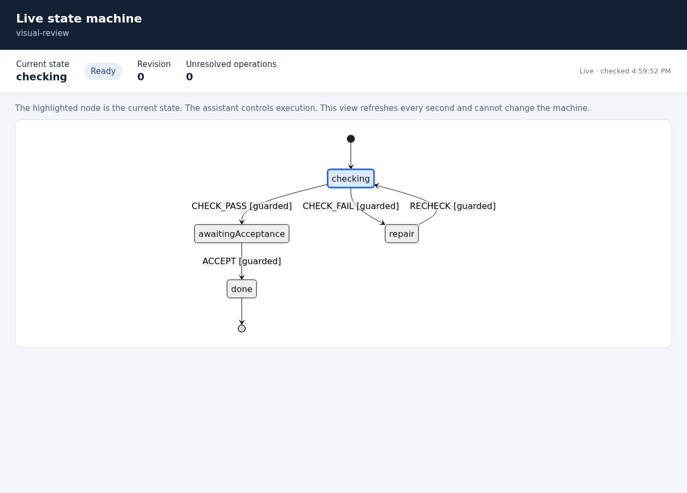

# State Machine Workflow

A portable agent skill with a passive [XState](https://stately.ai/docs) controller,
SQLite checkpoints and a live browser graph. The agent does the work and submits
explicit guarded transitions. The controller persists the definition, current
instance, facts, revision, stop flag and external-operation records.

It runs locally with Node.js 24 or newer and pnpm. It uses public dependencies;
there is no workflow server, automatic agent dispatcher or provider integration.

## Try it

```sh
git clone https://github.com/dearlordylord/state-machine-workflow.git
cd state-machine-workflow
pnpm install --frozen-lockfile
node run.mjs machine --help
node run.mjs machine .local/demo.sqlite init examples/review.json review-task "Review selected work"
node run.mjs machine .local/demo.sqlite inspect review-task
node run.mjs view .local/demo.sqlite review-task 5210
```

Open **http://127.0.0.1:5210**. Leave the viewer running and, in another terminal
in the clone, advance the synthetic example:

```sh
node run.mjs machine .local/demo.sqlite send review-task 0 examples/check-pass.json
node run.mjs machine .local/demo.sqlite send review-task 1 examples/accept.json
```

The graph follows `checking` → `awaitingAcceptance` → `done`. Revisions `0` and
`1` are specific to this fresh example; inspect before submitting your own event.
The example evidence is a fixture, not proof about your project.

To try failure, initialize a second instance and submit `examples/check-fail.json`
at revision `0`. It enters `repair`; `ACCEPT` is refused there. Submit
`examples/recheck.json` at revision `1` to return to `checking`.

From the clone, `pnpm run machine --help`, `pnpm run watch ...` and
`pnpm run view ...` also work. Use `pnpm run view`, since `pnpm view` names a
package-manager command. The `run.mjs` wrapper is preferable across projects
because it preserves the caller's working directory.

## Install as a skill

For a user-level installation:

```sh
SKILL_ROOT="${CODEX_HOME:-$HOME/.codex}/skills/state-machine-workflow"
git clone https://github.com/dearlordylord/state-machine-workflow.git "$SKILL_ROOT"
pnpm --dir "$SKILL_ROOT" install --frozen-lockfile
```

For a project-level installation, clone into
`.agents/skills/state-machine-workflow` and install dependencies there instead.
Use an unused destination; preserve an existing installation and its data when
updating. Ask the agent to use `$state-machine-workflow` or to “run this task as
a state machine.” A request only to draw or explain a machine does not start an
execution workflow.

When operating from another project, resolve the installed skill's absolute
path, keep your shell in that project, and invoke the wrapper:

```sh
node "$SKILL_ROOT/run.mjs" machine .local/task-machine.sqlite inspect <instance>
```

Database, event JSON and receipt-artifact paths are relative to the caller's
working directory. `pnpm --dir` is useful for installation; using it to run the
controller would change that path base. [SKILL.md](SKILL.md) contains the agent
workflow, and [definition and fact binding](references/definition.md) explains
how to adapt the example.

## Visualization



```sh
node run.mjs machine .local/demo.sqlite graph review-task
node run.mjs watch .local/demo.sqlite review-task
node run.mjs view .local/demo.sqlite review-task 5210
```

`graph` emits Mermaid text. `watch` refreshes the terminal view; add `--once` for
one snapshot. The browser view polls the selected persisted instance, highlights
the active state and shows its current status. These views are read-only. The viewer caches its checksum-pinned Mermaid
renderer under the skill root's `.local/` directory on first startup, which
requires network access if the asset is not cached.

The browser server binds to `127.0.0.1` by default. If it runs on an SSH host,
forward its port from your local computer:

```sh
ssh -L 5210:127.0.0.1:5210 user@host
```

Then open http://127.0.0.1:5210 locally. For containers, bind explicitly and publish/forward the port:

```sh
node run.mjs view .local/demo.sqlite review-task 5210 0.0.0.0
```

For example, publish container port `5210` to host port `5210` with your container
runtime (`-p 5210:5210`). Loopback inside a container is not the host's loopback. Provide a reachable forwarded URL when
sharing a running view; a remote machine's localhost URL is not accessible from
the reader's computer.

## Control and recovery

All mutations name an instance and its inspected revision:

```text
machine DATABASE init DEFINITION.json INSTANCE OBJECTIVE
machine DATABASE inspect INSTANCE
machine DATABASE send INSTANCE REVISION EVENT.json
machine DATABASE stop INSTANCE REVISION
machine DATABASE resume INSTANCE REVISION
machine DATABASE reserve INSTANCE REVISION OPERATION REQUEST.json
machine DATABASE resolve INSTANCE REVISION OPERATION RECEIPT.json
machine DATABASE graph INSTANCE
```

Prefix these with `node run.mjs` from the clone, or
`node "$SKILL_ROOT/run.mjs"` elsewhere. A stale revision refuses the mutation.
A failed check is different from acceptance; task completion depends on inspected
evidence, not just arrival at a final node.

`reserve` records an unknown outcome **before** a separately authorized external
call. No command performs that call. Unknown operations block advancement;
`resolve` records a receipt with `outcome` (`accepted`, `not-sent` or `failed`),
`providerReference`, `artifact` and `sha256`. It checks artifact bytes, not receipt
truth or provider authenticity. Inspect authoritative evidence before resolving;
missing acknowledgement does not justify retrying a potentially completed call.
Resolution can occur while stopped, and resuming alone does not resolve an
unknown operation. There is no external exactly-once guarantee.

Definitions are immutable and bound to the runtime source and XState version.
Changing runtime code can leave inspection available while mutations refuse.
A controlled migration can rebind a stopped instance to the current runtime in
a new destination store, retaining its facts, operations and stop status. It
requires exact source identities/revision and a reason; it does not infer
semantic compatibility. Inspect both runtimes' control meaning and use an
authorized plan. The source stays unchanged, and migration does not authorize
acceptance or retry of prior work. See the
[runtime migration procedure](references/definition.md#runtime-migration).
Time and cost limits
are agent-managed descriptions, not automatic timers or quota enforcement.

## Development

```sh
pnpm check
```

The controller uses XState 5.33.3, SQLite built into Node.js, and Zod validation.
See [LICENSE](LICENSE).
